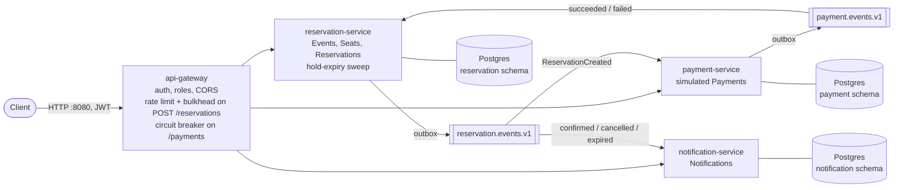

# Ticketing Platform

An event ticketing backend: customers hold Seats, pay, and the hold either
confirms or, if payment fails or never arrives, releases on its own. The two
hard parts are **concurrency**, since many buyers can grab the same Seat at once,
and **consistency across services**, since "hold the Seat" and "charge the
card" cannot be one database transaction. The first is handled by optimistic
locking on `Seat`, the second by a choreographed saga over Kafka with a
compensating step. A single authenticated gateway sits in front, with a rate
limit and a bulkhead on the flash-sale route.

Java 21, Spring Boot 3.4, Spring Cloud Gateway MVC, Kafka (KRaft), Postgres,
Resilience4j, Testcontainers, Docker Compose.



Only the gateway publishes a port. The services trust the identity it forwards,
reach each other only through Kafka, and each owns one schema in a shared
Postgres instance.

## What it demonstrates

- **No oversells under contention.** 200 concurrent buyers raced for 5 Seats
  through the gateway, and no Seat was ever sold or held twice, checked
  through the API and in the database. With the `@Version` lock removed, the
  same test sold the 5 Seats to 13 Reservations and failed.
  [`docs/load-test.md`](docs/load-test.md) has the results, the hardware and the
  rerun command.
- **The saga, end to end, with every outcome.** A tested walkthrough
  ([below](#the-walkthrough)) drives each branch against the running stack:

  | Payment | Reservation | Seats |
  | --- | --- | --- |
  | succeeds | `CONFIRMED` | `SOLD` |
  | declined | `CANCELLED` (compensated) | released |
  | never arrives | `EXPIRED` by the sweep | released |

  It also shows a late payment after expiry being ignored safely
  ([ADR 007](docs/adr/007-payment-outcome-guard.md)) and then refunded
  ([ADR 017](docs/adr/017-refund-late-settled-payment.md)), and one request followed
  across all four services by its correlation id.
- **At-least-once delivery made safe.** Transactional outboxes on the
  producing services, idempotent consumers keyed on event id, and, in the two
  services that drive the saga, poison messages retried and then
  dead-lettered ([ADR 008](docs/adr/008-poison-message-handling.md)).
- **A trust boundary the build checks.** `platform-tests` asks
  `docker compose config` what each container would publish, and fails if
  anything but the gateway is reachable from the host.

## Design decisions

[`docs/architecture.md`](docs/architecture.md) tells the whole story: the
saga step by step, the routes and roles, and the reasons behind each
non-obvious choice. [`CONTEXT.md`](CONTEXT.md) is the domain glossary. Each
main decision has a short record in [`docs/adr/`](docs/adr):

| ADR | Decision |
| --- | --- |
| [001](docs/adr/001-gateway-mvc.md) | Spring Cloud Gateway MVC instead of the reactive gateway |
| [002](docs/adr/002-gateway-trust-boundary.md) | JWT validated only at the gateway; identity comes from the token |
| [003](docs/adr/003-outbox-pattern.md) | Transactional outbox instead of writing to the database and Kafka separately |
| [004](docs/adr/004-idempotent-consumers.md) | Idempotent Kafka consumers via a `processed_events` table |
| [005](docs/adr/005-schema-per-service.md) | One schema per service in one Postgres instance |
| [006](docs/adr/006-optimistic-locking-seats.md) | Optimistic locking on Seat instead of pessimistic row locks |
| [007](docs/adr/007-payment-outcome-guard.md) | Ignore a payment outcome for a Reservation that is no longer pending |
| [008](docs/adr/008-poison-message-handling.md) | Poison messages: retry, then dead-letter |
| [009](docs/adr/009-processed-events-retention.md) | `processed_events` retention, and why there is no cleanup job yet |
| [010](docs/adr/010-notification-service-no-outbox.md) | notification-service has no outbox |
| [011](docs/adr/011-notification-read-ownership.md) | Notifications are read by the caller's identity; operators get a separate route |
| [012](docs/adr/012-gateway-is-the-only-published-surface.md) | The gateway is the only published HTTP surface |
| [013](docs/adr/013-infrastructure-ports-follow-the-gateway-rule.md) | Postgres, Kafka and the Kafka UI follow the same no-published-port rule |
| [014](docs/adr/014-reservation-read-ownership.md) | Reservations are read by the caller's identity |
| [015](docs/adr/015-gateway-login-abuse-prevention.md) | Failed logins counted per account and per address |
| [016](docs/adr/016-payment-read-ownership.md) | Payments are read by the caller's identity |

## Running it

The gateway needs a signing key and the demo callers need passwords, and none
of them is committed — a key or a working password in this repository is a
credential in every clone and every fork. Both are supplied at runtime:

```bash
cp .env.example .env
# fill in the four values; generate the key with: openssl rand -base64 48
docker compose up --build
```

Compose stops with the name of the missing variable rather than substituting
an empty one, and the gateway independently refuses to start without a signing
key of at least 32 bytes or without a password for every configured caller —
so forgetting one is a startup failure, not a deployment signing tokens with a
key nobody chose. `.env` is gitignored; `.env.example` holds placeholders only.

- Gateway: `http://localhost:8080` — the only published port in the default
  stack, on every interface

The services behind the gateway, and the infrastructure they run on, publish
nothing to the host. The gateway is where a token is checked and a role is
enforced, and the services behind it trust the identity headers it sets rather
than checking anything themselves, so a published port would be a way around
both (see [`docs/adr/012`](docs/adr/012-gateway-is-the-only-published-surface.md)).
The database is the widest read of all — every service's schema is in it, behind
credentials that are in the compose file — and the Kafka UI shows the whole event
history while authenticating nobody, so they are held to the same rule
([`docs/adr/013`](docs/adr/013-infrastructure-ports-follow-the-gateway-rule.md)).

To debug a service directly — `curl localhost:8084/actuator/health`, an IDE
attached to the process — or to reach the infrastructure — `psql`, a Kafka CLI,
the Kafka UI at `http://localhost:8090` — ask for it explicitly:

```bash
docker compose -f docker-compose.yml -f docker-compose.debug.yml up --build
```

That publishes reservation-service `:8082`, payment-service `:8083`,
notification-service `:8084`, postgres `:5432`, kafka `:29092` and the Kafka UI
`:8090` on `127.0.0.1`, for as long as that stack is up. A port bound to
loopback is reachable by any process on this machine, which includes anything
that can skip the gateway's authentication and read the database, so it is for
debugging and not for anything else.

Note that a service run on the host with `mvn spring-boot:run` needs this
override: every service's `application.yml` defaults to `localhost:5432` and
`localhost:29092`, so against the default stack it will find nothing listening.
Inside the compose stack nothing does — the services reach the database as
`postgres:5432` and the broker as `kafka:9092`, over the compose network.

## Authentication is a demo credential set

The login surface is three configured callers — `customer`, `organizer` and
`admin` — whose passwords come from `.env` and are compared against the values
in `application.yml`. It is not an identity provider, and it is not
production-grade password authentication. Specifically:

- **No password store.** The configured value *is* the credential. There is no
  password database, no hashing at rest, and no user-facing registration.
- **A password change revokes nothing.** It changes what `/auth/login` accepts
  from then on. A token issued before the change stays valid until it expires.
- **A token is valid until its expiry** (`JWT_TTL`, one hour by default) and
  there is no refresh token, so "logging out" means "stop sending it".
- **Failed logins are counted, per process.** `/auth/login` refuses a caller over
  a limit on two keys at once — five failures per account, twenty per remote
  address, in a five-minute window — and answers `429` with a `Retry-After`. A
  correct password is refused exactly like a wrong one while the limit is spent, so
  the endpoint does not reveal *which* credentials exist any more than it did
  before, and now says nothing about how many attempts it will answer. Two limits
  it does not overcome: callers behind one NAT share the address budget, and
  counters live in each gateway, so N replicas behind a load balancer mean N times
  the budget. The flash-sale rate limit on `POST /api/v1/reservations` is a
  different mechanism on a different route and does not cover this.
- **Roles are configuration**, not something a user holds or changes.

[`docs/adr/002`](docs/adr/002-gateway-trust-boundary.md) records the trust
boundary these credentials sit behind, and what it costs;
[`docs/adr/015`](docs/adr/015-gateway-login-abuse-prevention.md) records the
login limiter and the properties it does not have.

## Example requests

The demo logins are `customer`, `organizer` and `admin`, with the passwords you
set in `.env`. A token's subject is the caller's own id — `42` for `customer` —
and for a caller that is a Customer that id is its `Customer.id`, which is the
only case the gateway puts `X-Customer-Id` on the request it forwards. An
organizer and an admin have ids too, but holding those roles is not being a
Customer, so they get no such header and a value you set by hand is overwritten
or dropped either way.

Reservations are the Customer's alone: `POST /api/v1/reservations` answers an
organizer with 403, because a Reservation belongs to a Customer and there is no
Customer id to book an organizer's against. Browsing Events stays open to any
authenticated caller, since a Customer has to be able to look before buying.

`GET /api/v1/notifications` is the Customer's own inbox and takes no customer id
at all — it reads the one the gateway verified, so a `?customerId=` on it is
either redundant or refused. An operator reads someone else's inbox on a separate,
`ADMIN`-only route, kept separate so the self-service read can never be widened:
`GET /api/v1/admin/customers/<id>/notifications`. See
`docs/adr/011-notification-read-ownership.md`.

Reservations are read the same way, by the same rule. `GET
/api/v1/reservations/<id>` and `GET /api/v1/reservations` are scoped by that same
verified header and by nothing else: the path or query picks *which* reservation,
and the header says *whose*. Someone else's reservation is a 404 — the same answer
as an id that was never issued, so the response does not confirm it exists — and a
`?customerId=` naming somebody else is refused with 400. Both reads need the
gateway's header, so neither is reachable without it. See
`docs/adr/014-reservation-read-ownership.md`.

Payments follow the same rule. `GET /api/v1/payments/<reservationId>` returns the
payment behind one of the caller's own reservations. Someone else's reservation
id gets the same 404 as one that was never issued. It is Customer-only at the
gateway. See `docs/adr/016-payment-read-ownership.md`.

### The walkthrough

Every command below was run against `docker compose up --build`, in order, on an
empty database; the ids in the expected output are what a fresh stack hands out,
so on a stack that has seen earlier runs use the ids your own responses return.
To watch a Hold lapse without waiting ten minutes, start the stack with a short
one:

```bash
HOLD_DURATION=PT30S docker compose up --build -d
until curl -s -o /dev/null localhost:8080/auth/login; do sleep 2; done   # the gateway is listening
```

The knobs the walkthrough leans on, both read by `docker-compose.yml` from the
shell or `.env`:

| Variable | Default | What it decides |
| --- | --- | --- |
| `HOLD_DURATION` | `PT10M` | how long a Reservation holds its Seats before the sweep may expire it |
| `PAYMENT_DECLINE_THRESHOLD_CENTS` | `50000` | the simulated payment declines any Reservation whose total is **this or more**, and succeeds below it |

#### Log in

```bash
set -a; . ./.env; set +a   # the demo passwords, into this shell only

ORG=$(curl -s -X POST localhost:8080/auth/login -H "Content-Type: application/json" \
  -d "{\"username\":\"organizer\",\"password\":\"$DEMO_ORGANIZER_PASSWORD\"}" \
  | sed -E 's/.*"token":"([^"]+)".*/\1/')
CUS=$(curl -s -X POST localhost:8080/auth/login -H "Content-Type: application/json" \
  -d "{\"username\":\"customer\",\"password\":\"$DEMO_CUSTOMER_PASSWORD\"}" \
  | sed -E 's/.*"token":"([^"]+)".*/\1/')

# The gateway is up before the services behind it, and a hop to one that is
# still starting answers 500. Wait until all three answer:
until curl -s -o /dev/null -w '%{http_code}' localhost:8080/api/v1/events -H "Authorization: Bearer $ORG" | grep -q 200 \
   && curl -s -o /dev/null -w '%{http_code}' localhost:8080/api/v1/payments/999999 -H "Authorization: Bearer $CUS" | grep -q 404 \
   && curl -s -o /dev/null -w '%{http_code}' localhost:8080/api/v1/notifications -H "Authorization: Bearer $CUS" | grep -q 200
do sleep 2; done
```

A login answers `{"token":"…","roles":["ORGANIZER"],"expiresAt":"…"}`; the
token is good for an hour (`JWT_TTL`). On a cold start the services take a
minute or more to come up after the gateway; the loop above is what tells you
they have.

#### Create an Event with Seats (Organizer)

Two cheap Seats for the success path, two dear ones for the decline, and one for
the expiry.

```bash
curl -s -X POST localhost:8080/api/v1/events \
  -H "Authorization: Bearer $ORG" -H "Content-Type: application/json" \
  -d '{"name":"Radiohead","venue":"The Fillmore","eventDate":"2026-11-01T20:00:00Z","seats":[
        {"section":"A","row":"1","seatNumber":1,"priceCents":15000},
        {"section":"A","row":"1","seatNumber":2,"priceCents":15000},
        {"section":"B","row":"1","seatNumber":1,"priceCents":30000},
        {"section":"B","row":"1","seatNumber":2,"priceCents":30000},
        {"section":"C","row":"1","seatNumber":1,"priceCents":5000}]}'
# 201 {"eventId":1,"seatIds":[1,2,3,4,5]}

curl -s "localhost:8080/api/v1/events/1/seats?status=AVAILABLE" -H "Authorization: Bearer $CUS"
# 200 — all five Seats, each "status":"AVAILABLE"
```

#### 1. Payment succeeds: CONFIRMED, Seats SOLD

Seats 1 and 2 total 30000 cents, under the decline threshold.

```bash
curl -s -X POST localhost:8080/api/v1/reservations \
  -H "Authorization: Bearer $CUS" -H "Content-Type: application/json" \
  -d '{"eventId":1,"seatIds":[1,2]}'
# 201 {"id":1,"customerId":42,"status":"PENDING_PAYMENT","amountCents":30000,
#      "expiresAt":"…",  "seats":[… "status":"HELD" …]}

# A few seconds later, once the saga has run:
curl -s localhost:8080/api/v1/reservations/1 -H "Authorization: Bearer $CUS"
# 200 {"id":1,"status":"CONFIRMED", … "seats":[… "status":"SOLD" …]}

curl -s localhost:8080/api/v1/payments/1 -H "Authorization: Bearer $CUS"
# 200 {"reservationId":1,"amountCents":30000,"status":"SUCCEEDED","settledAt":"…"}

curl -s localhost:8080/api/v1/notifications -H "Authorization: Bearer $CUS"
# 200 {"items":[{"reservationId":1,"type":"RESERVATION_CONFIRMED",
#      "message":"Your reservation 1 is confirmed. Seats 1, 2 are yours.", …}],"nextCursor":null}
# (the Seats are listed in no particular order)
```

#### 2. Payment declined: CANCELLED, Seats released

Seats 3 and 4 total 60000 cents, over the threshold, so the payment fails and
reservation-service compensates.

```bash
curl -s -X POST localhost:8080/api/v1/reservations \
  -H "Authorization: Bearer $CUS" -H "Content-Type: application/json" \
  -d '{"eventId":1,"seatIds":[3,4]}'
# 201 {"id":2,"status":"PENDING_PAYMENT","amountCents":60000, …}

# A few seconds later:
curl -s localhost:8080/api/v1/reservations/2 -H "Authorization: Bearer $CUS"
# 200 {"id":2,"status":"CANCELLED", … "seats":[… "status":"AVAILABLE" …]}

curl -s localhost:8080/api/v1/payments/2 -H "Authorization: Bearer $CUS"
# 200 {"reservationId":2,"amountCents":60000,"status":"FAILED", …}

curl -s "localhost:8080/api/v1/events/1/seats?status=AVAILABLE" -H "Authorization: Bearer $CUS"
# 200 — Seats 3, 4 and 5: the declined pair is back on sale

curl -s localhost:8080/api/v1/notifications -H "Authorization: Bearer $CUS"
# newest item: "type":"RESERVATION_CANCELLED",
#   "message":"Your reservation 2 was cancelled because the payment was declined. Seats 3, 4 have been released."
```

Every payment settles within seconds, so the only way to make one fail on demand
is the threshold: reserve at least `PAYMENT_DECLINE_THRESHOLD_CENTS` worth of
Seats, or start the stack with a lower one (`PAYMENT_DECLINE_THRESHOLD_CENTS=0`
declines every payment).

#### 3. The Hold lapses: EXPIRED, Seats released

A Hold only lapses if no payment outcome arrives first, and the simulated payment
always answers within seconds. Stopping payment-service stands in for a customer
who never completes checkout:

```bash
docker compose stop payment-service

curl -s -X POST localhost:8080/api/v1/reservations \
  -H "Authorization: Bearer $CUS" -H "Content-Type: application/json" \
  -d '{"eventId":1,"seatIds":[5]}'
# 201 {"id":3,"status":"PENDING_PAYMENT","expiresAt":"<now + HOLD_DURATION>", …}

# Once expiresAt has passed (about 30 s with HOLD_DURATION=PT30S), the sweep
# releases the Seat on its own:
curl -s "localhost:8080/api/v1/events/1/seats?status=AVAILABLE" -H "Authorization: Bearer $CUS"
# 200 — Seats 3, 4 and 5

curl -s localhost:8080/api/v1/reservations/3 -H "Authorization: Bearer $CUS"
# 200 {"id":3,"status":"EXPIRED", … "seats":[… "status":"AVAILABLE" …]}

curl -s localhost:8080/api/v1/notifications -H "Authorization: Bearer $CUS"
# newest item: "type":"RESERVATION_EXPIRED",
#   "message":"Your reservation 3 expired before payment completed. Seat 5 has been released."
```

Bring payment-service back and it settles the abandoned Reservation late. The
outcome is ignored ([ADR 007](docs/adr/007-payment-outcome-guard.md)): the
Reservation stays `EXPIRED` and its Seat stays on sale. The money is not kept,
though. reservation-service reports the late success, payment-service refunds
it, and the Customer is told
([ADR 017](docs/adr/017-refund-late-settled-payment.md)).

```bash
docker compose start payment-service

# Once it has caught up (around half a minute while it starts):
curl -s localhost:8080/api/v1/payments/3 -H "Authorization: Bearer $CUS"
# 200 {"reservationId":3,"amountCents":5000,"status":"REFUNDED","settledAt":"…","refundedAt":"…", …}

curl -s localhost:8080/api/v1/reservations/3 -H "Authorization: Bearer $CUS"
# 200 {"id":3,"status":"EXPIRED", …}

curl -s localhost:8080/api/v1/notifications -H "Authorization: Bearer $CUS"
# newest two items: "type":"PAYMENT_REFUNDED",
#   "message":"Your payment for reservation 3 was refunded because it arrived after the reservation expired."
# then the "RESERVATION_EXPIRED" from before
```

#### Following one request through the logs

Every response carries the `X-Correlation-Id` the gateway decided on, and every
service logs it as `correlationId` on each line written for that request, Kafka
hops included. Add `-D -` to a reservation's `POST` to see its id, then:

```bash
docker compose logs --no-log-prefix api-gateway reservation-service payment-service notification-service \
  | grep '"correlationId":"<that id>"'
```

For the reservation in flow 1 that is the gateway's `POST /api/v1/reservations -> 201`,
`Reservation 1 placed`, `Payment for reservation 1 SUCCEEDED`, `Reservation 1
confirmed`, and notification-service's `Simulated send: RESERVATION_CONFIRMED`.

## Testing

- Unit tests: state transitions, concurrency-conflict handling — no Spring
  context.
- MockMvc integration tests per service.
- Testcontainers integration tests (Postgres + Kafka): the outbox -> Kafka
  -> consumer pipeline, and specifically the compensating-transaction path
  (a `PaymentFailed` event actually releases the held seats).
- `platform-tests`: the deployment rather than any one service — chiefly that no
  internal service publishes a port, which is what makes the gateway the trust
  boundary. It reads the compose files and, where Docker is installed, asks
  `docker compose config` for the model the containers would start from.
- The seat-contention load test, in `platform-tests` but run only under
  `-Pload-test`: 200 concurrent buyers race for 5 Seats through the gateway,
  and no Seat is ever sold twice. Results, hardware and the rerun command are
  in [`docs/load-test.md`](docs/load-test.md).

Run everything: `mvn verify` from the repo root. It needs Docker for the
Testcontainers suites, and it starts its own Postgres and Kafka, so stop the
compose stack first on a small machine: the two together outgrow a few-GB WSL
VM, and Docker stops answering rather than failing cleanly.

## Known gaps

- **A payment that settles after its Hold expired is not refunded.** The
  Reservation side is safe ([ADR 007](docs/adr/007-payment-outcome-guard.md)):
  the late outcome is ignored and the Seats stay on sale. But the Payment stays
  `SUCCEEDED`, so with a real charge the customer would pay and get no ticket.
  The walkthrough's flow 3 shows it. The fix is a compensating refund on the
  payment side, tracked in
  [#52](https://github.com/skibkitty/ticketing-platform/issues/52).
- **Payments are simulated.** payment-service declines by a price threshold
  instead of calling a provider. The saga's mechanics are the point, not a
  PCI-scope integration.
- **`processed_events` grows forever.** There is no retention job yet
  ([ADR 009](docs/adr/009-processed-events-retention.md)).
- **Static JWT signing key.** One shared secret, no rotation, no JWKS.
- **Log-based tracing only.** Correlation ids follow a request across every
  service and Kafka hop, but there is no OpenTelemetry collector or UI.
- **No waiting room.** The rate limit protects the reservation route, but there
  is no queue in front of it for an on-sale moment.

[`docs/architecture.md`](docs/architecture.md#whats-intentionally-out-of-scope)
lists what was left out on purpose and why.

## How this was built

I wrote the specification
([#1](https://github.com/skibkitty/ticketing-platform/issues/1)), split it
into vertical-slice tickets on GitHub Issues, and made the design decisions
recorded in the ADRs. AI coding agents implemented most of the tickets:
opencode early on, then Claude Code. Each ticket was done on its own branch, as
a pull request that closes it. I reviewed every pull request, and merging was
always my decision, never an agent's. Commits and pull requests from the later
tickets credit Claude as co-author.

The rules the agents worked under are part of the repository:

- [`AGENTS.md`](AGENTS.md): the entry point an agent reads first.
- [`docs/agents/`](docs/agents): how tickets are written and triaged
  (`needs-triage` → `ready-for-agent`), where the domain language lives, and the
  git workflow.
- [`.githooks/pre-push`](.githooks/pre-push): refuses any direct push to `main`.
  `main` is also protected on GitHub: a pull request with green CI is required.
- A merge is a GitHub API call, which no git hook can see, so "merging is the
  human's decision" is a written rule rather than a technical control.
  [`docs/agents/git-workflow.md`](docs/agents/git-workflow.md) says why.

The walkthrough under "Example requests" was run by hand against the real
stack before it was written down. It found two bugs the test suites had
missed: service images that could not start, and a response header sent twice.
Both were fixed first. The load test was also run against the real stack, and
was itself checked by removing the lock it tests.
